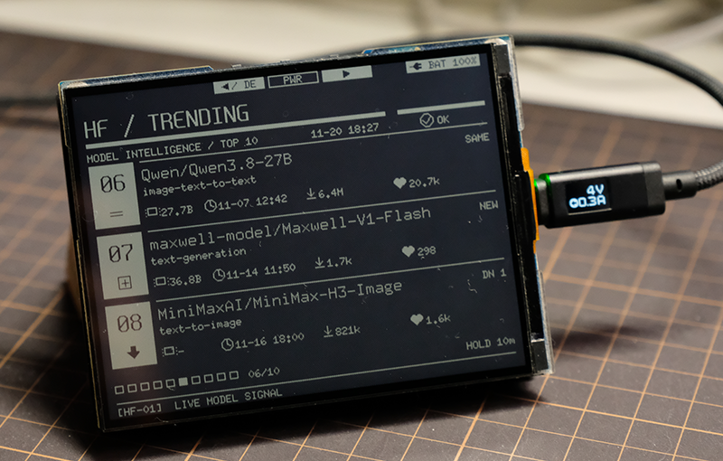

# Hugging Face Model Trending Monitor



本项目使用 [**Qwen4-Max**](https://qwen.ai/blog?id=qwen4-max) 模型构建.  

关联视频[https://www.bilibili.com/video/BV1nGyxzKEcF/](https://www.bilibili.com/video/BV1nGyxzKEcF/).  

让 ESP32-S3-RLCD-4.2 显示 Hugging Face 模型热榜程序。服务端是一个本地常驻的 Node 服务，每小时抓取 Trending Top 10，和上一轮快照比较名次后通过 HTTP 提供给设备；同一个服务还会定时用大模型生成 AI 像素日历画面。

```text
Hugging Face API -> server/ (Node) -> data/trending-state.json
LLM + Open-Meteo -^      |
                         +-> HTTP TSV / 1-bit frames -> ESP32-S3 -> ST7305
```

服务端使用 [Hugging Face Hub models API](https://huggingface.co/docs/huggingface_hub/package_reference/hf_api)，按 `trendingScore` 排序。

⚠️ 注意: 这个硬件本身屏幕上电可能有bug, 所以不推荐购买.

## 本地配置

复制示例配置并填写自己的 Wi-Fi 与 Worker 地址：

```powershell
Copy-Item client\config.example.h client\config.h
```

`client/config.h` 不会进入 git。`WIFI_SSID` 仍是 `your-ssid` 时，固件进入 DEMO 模式：不连接 Wi-Fi，用内置样例画四页，方便检查排版。改成真实的 SSID、密码和 `TRENDING_API_URL` 后重新烧录，才会每小时拉取服务端。

## 服务端

所有运行时配置（大模型 API、所在城市、调试页面监听地址和端口、HF 代理、日历生成间隔等）都在仓库根目录的 `.env`：

```powershell
Copy-Item .env.example .env
cd server
npm install
npm test
npm run serve
```

启动后打开 `http://127.0.0.1:8787/`：首页显示两个模块的状态，`/trending` 是热榜调试表格，`/calendar/` 是 AI 日历画廊。设备接口是 `GET /api/trending.tsv`，格式与原 Cloudflare Worker 完全一致。

让 ESP32 使用本地服务：在 `.env` 设置 `HTTP_HOST=0.0.0.0`，然后把 `client/config.h` 的 `TRENDING_API_URL` 改成 `http://<电脑局域网IP>:8787/api/trending.tsv`、`CALENDAR_API_URL` 改成 `http://<电脑局域网IP>:8787/api/calendar/device.bin`，重新烧录。`CALENDAR_API_URL` 留空则关闭日历页。固件同时支持 `http://` 和 `https://`。Windows 防火墙需要放行 8787 端口。

`/api/calendar/device.bin` 把最新一次日历输出打包成约 80 KB 的二进制：400x300 底图、4 种抖动各 12 帧场景动画（每种一张关键帧加逐帧 XOR 差分）、文字滚动条带（1bpp，XBM 位序）。设备每 5 分钟用 `If-None-Match` 检查一次，没有新内容时服务端返回 `304`。

本地网络访问不了 `huggingface.co` 时，把 `HF_PROXY` 设为 HTTP 代理（只用于 HF 请求）。`hf-mirror.com` 不支持本接口需要的 `expand=` 参数，不能代替。接口、TSV 字段和日历输出见 [server/README.md](server/README.md)。

## AI 日历

AI 日历是屏幕上和热榜轮换显示的第二个页面：左边是一段由大模型现写的 Three.js 像素动画，右边是时间、天气、节气卡片和一栏滚动短文案。每次生成都会根据当时的日期、时段、农历、节气、节日和天气重新创作画面。

400x300 画面分三块：

- 左侧场景区 262x288，12 帧 4fps 循环动画，左下角标注农历日期。
- 右上信息卡 120x138，显示生成时刻、日期星期、城市天气气温，以及一个反白方框。
- 右下文案栏 120x144，竖向滚动显示短文案。

### 生成流程

1. 用 [Open-Meteo](https://open-meteo.com/)（无需 key）拉取 `CITY_LAT` / `CITY_LON` 的当前天气和当日最高最低温。失败会重试 3 次，再不行就用 3 小时内的缓存 `data/cache/weather.json`。
2. 用 `lunar-javascript` 计算农历、干支生肖年、当日节气或距下一个节气的天数，以及农历和公历节日。卡片里的反白方框优先显示节日，其次是当天节气，否则显示"距 XX 还有 N 天"。
3. 把这些信息发给大模型，要求它返回 JSON：一个场景标题、2~4 句呼应时间和天气的中文短文案，以及一段 `scene.js`。宿主会对 `t = 0, 1/12, ..., 1` 各调用一次场景代码，要求首尾无缝衔接。
4. 在无头 Chromium（Playwright + SwiftShader）里渲染 12 帧，分别用 `atkinson`、`bayer4`、`floyd`、`threshold` 四种算法抖动成 1-bit，再和信息卡、滚动文案条合成 400x300 画面。
5. 检查画面墨量、帧间运动和循环接缝。代码报错或检查不通过时，把错误信息回传给大模型重写，最多重试 `LLM_MAX_RETRIES` 次；最后一次只要静帧可用就接受。全部失败，或者没有配置 `LLM_API_KEY` 时，使用内置的兜底场景，所以不接大模型也能跑通。

滚动文案由大模型写的短句加上自动生成的事实条目组成（节日、节气倒计时、当日天气温度区间、农历日期）。

### 配置

日历相关的配置都在 `.env`：

| 变量 | 说明 |
|---|---|
| `LLM_BASE_URL` / `LLM_API_KEY` / `LLM_MODEL` | 任意 OpenAI 兼容的 `/chat/completions` 接口 |
| `LLM_JSON_MODE` | 接口不支持 `response_format: json_object` 时设为 `0` |
| `LLM_TEMPERATURE` / `LLM_MAX_RETRIES` / `LLM_TIMEOUT_MS` | 采样温度、失败重写次数、单次请求超时 |
| `CITY_NAME` / `CITY_LAT` / `CITY_LON` / `TZ` | 天气位置、卡片上的城市名和时区 |
| `CALENDAR_INTERVAL_MIN` | 生成间隔，从本地零点对齐，`60` 即每个整点 |
| `CALENDAR_RUN_ON_START` | 服务启动时立即生成一次 |
| `CALENDAR_KEEP` | 只保留最近 N 次定时输出，`0` 为全部保留 |
| `CALENDAR_GALLERY_LIMIT` | `/calendar/` 画廊显示的数量 |

渲染依赖 Playwright 的 Chromium。首次使用前在 `server/` 下安装：

```powershell
npx playwright install chromium
```

下载慢时，可以用环境变量 `CHROMIUM_PATH` 指向已有的 Chromium 或 Chrome；服务也会自动使用 Playwright 缓存目录里已有的其他版本。字体在第一次生成时自动下载到 `server/fonts/`，`npm run fonts` 会额外下载中文兜底字体。

### 手动生成与调试

服务运行时，可以在 `/calendar/` 画廊查看每次的输出和动画，或者 `POST /api/calendar/generate` 立即生成一次。也可以在 `server/` 下离线运行：

```powershell
# Generate one frame for a given time and weather; --no-llm uses the fallback scene
npm run generate -- --date 2026-12-21T19:30 --weather snow
# Generate a set of preset dates and weathers
npm run batch
# Re-render saved scene.js and ticker with the current layout, without calling the LLM
npm run recompose
# Rebuild the gallery page
npm run gallery
```

每次输出在 `server/data/calendar/<时间>_<名称>_<id>/`，包括 `frame.png`、`anim.gif`、各抖动算法的逐帧 PNG、模型写的 `scene.js`，以及记录上下文、提示词、模型原始回复和每次重试原因的 `meta.json`。调整布局后用 `recompose` 重新合成，不需要再花大模型调用。

## 烧录

用 USB 连接板子，双击 `flash.bat`，或在 PowerShell 中运行：

```powershell
.\flash.ps1
```

脚本会检查 `client/config.h`、安装缺失的 ESP32 core 3.3.0 和 U8g2 2.36.19、按需生成字体、识别 `VID_303A/PID_1001` 端口，然后编译并烧录。多块板子同时连接时：

```powershell
.\flash.ps1 -Port COM3
```

串口波特率 115200。启动时会打印 `SELFTEST PASS`、Wi-Fi 或 DEMO 状态，以及每 10 秒一次的页码。成功拉取后约 3600 秒刷新一次；失败时保留上一份数据，状态显示 `STALE`，5 分钟后重试。

## 屏幕

- 标题 24px，正文 16px，字体是 Sarasa Fixed SC Semibold，阈值 128，只包含 ASCII `0x20`–`0x7E`。
- 名次变化用 `UP 5`、`DN 5`、`NEW`、`--` 表示。从第 6 名升到第 1 名是 `UP 5`。
- 每页最多 3 条，10 秒翻页，Top 10 共四页。界面使用粗黑标题轨道、反白排名块、几何趋势箭头以及参数、时间、下载、点赞图标。
- 只有数据、状态或页码变化时才刷新 RLCD。
- 左侧 `KEY` 短按上一页，右侧 `BOOT` 短按下一页；手动翻页后自动轮播暂停 10 分钟。
- 自动轮播：HF 排行翻完一圈（第 10 条展示 10 秒后）切到日历页，日历显示 10 秒后回到排行第 1 条。日历页播放 4fps 的场景循环动画，右下角文字每 60ms 滚动 1px，并在每条开头停 2.4 秒。还没拉到日历时跳过日历页。
- 双击左侧 `KEY` 在 HF 排行和日历之间手动切换，之后自动轮换暂停 10 分钟。单击 `KEY` 需要等 350ms 确认不是双击，所以上一页会稍有延迟。
- 在日历页，`KEY` 短按和 `BOOT` 短按切换渲染模式（`atkinson`、`bayer4`、`floyd`、`threshold`，都带动画，默认 `bayer4`），左上角显示 1.5 秒模式名；选择保存在 NVS，重启后保留，同时暂停自动轮换 10 分钟。
- 长按左侧 `KEY` 进入或退出 Debug 页，显示 IP、SSID、RSSI、网关、网关 ICMP 延迟、API HTTP 状态及请求耗时、日历拉取结果。Debug 页中短按 `KEY` 退出，短按 `BOOT` 立即重试 API。
- 顶部第三个 `PWR` 按钮连接电源锁存芯片，固件无法读取；长按会关闭设备。

重新生成字体：

```powershell
.\generate-font.ps1 -Force
```

Sarasa Gothic 使用 [SIL Open Font License 1.1](https://github.com/be5invis/Sarasa-Gothic/blob/master/LICENSE)。

## 客户端纯函数测试

解析、名次标签、数字缩写和 400×300 排版检查在 `client/self_test.cpp`。固件启动时会跑一遍。有本机 C++ 编译器时也可以单独运行：

```powershell
g++ -std=c++17 tools/test_trending.cpp client/self_test.cpp client/trending.cpp -o tools/test_trending.exe
.\tools\test_trending.exe
```

## 硬件

- 显示 SCK：GPIO11
- 显示 MOSI：GPIO12
- 显示 DC：GPIO5
- 显示 CS：GPIO40
- 显示复位：GPIO41
- BOOT 按钮：GPIO0，低电平按下
- KEY 按钮：GPIO18，低电平按下
