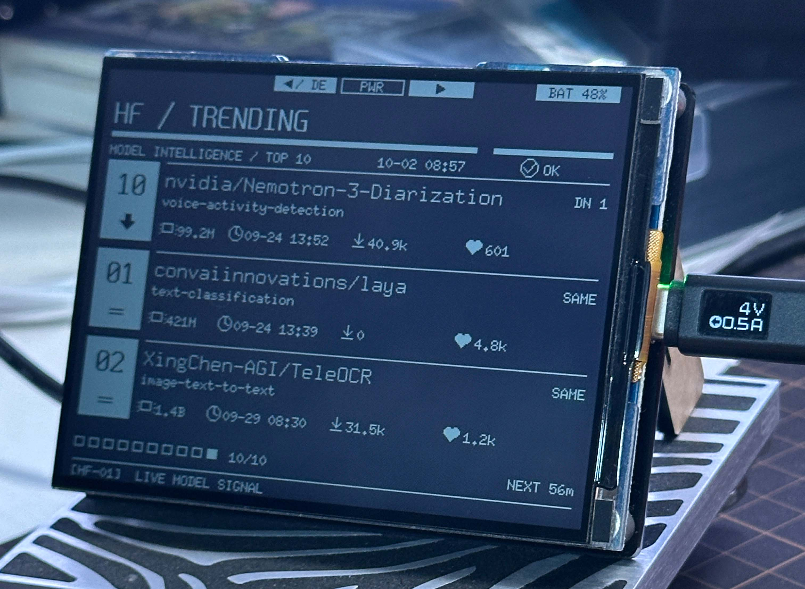

# Hugging Face Model Trending Monitor



本项目使用 [**Space Bunny Alpha**](https://openrouter.ai/stealth/space-bunny-alpha) 模型构建.

让 ESP32-S3-RLCD-4.2 显示 Hugging Face 模型热榜程序。服务端使用 Cloudflare Worker 每小时抓取 Trending Top 10，然后和上一轮快照比较名次，形成 API, 设备每隔一小时放访问 API 更新数据。

```text
Hugging Face API -> Cloudflare Worker -> Workers KV
                         |
                         +-> HTTPS TSV -> ESP32-S3 -> ST7305
```

服务端使用 [Hugging Face Hub models API](https://huggingface.co/docs/huggingface_hub/package_reference/hf_api)，按 `trendingScore` 排序。额度说明见 [Cloudflare Workers limits](https://developers.cloudflare.com/workers/platform/limits/)。项目每天约 24 次 KV 写入，低于 1,000 次的免费 Plan 写入上限。所以可以白嫖。

⚠️ 注意: 这个硬件本身屏幕上电可能有bug, 所以不推荐购买.

## 本地配置

复制示例配置并填写自己的 Wi-Fi 与 Worker 地址：

```powershell
Copy-Item client\config.example.h client\config.h
```

`client/config.h` 不会进入 git。`WIFI_SSID` 仍是 `your-ssid` 时，固件进入 DEMO 模式：不连接 Wi-Fi，用内置样例画四页，方便检查排版。改成真实的 SSID、密码和 `TRENDING_API_URL` 后重新烧录，才会每小时拉取服务端。

## 服务端

```powershell
cd server
npm install
npm test
npm run test:live
npm run dev
```

已经部署到 `https://hf-trending.karminski.workers.dev`。设备地址是 `https://hf-trending.karminski.workers.dev/api/trending.tsv`。

接口是 `GET /api/trending.tsv` 和 `GET /healthz`。部署细节、TSV 字段和免费额度见 [server/README.md](server/README.md)。

## 烧录

用 USB 连接板子，双击 `flash.bat`，或在 PowerShell 中运行：

```powershell
.\flash.ps1
```

脚本会检查 `client/config.h`、安装缺失的 ESP32 core 3.3.0 和 U8g2 2.36.19、按需生成字体、识别 `VID_303A/PID_1001` 端口，然后编译并烧录。多块板子同时连接时：

```powershell
.\flash.ps1 -Port COM3
```

串口波特率 115200。启动时会打印 `SELFTEST PASS`、Wi-Fi 或 DEMO 状态，以及每 10 秒一次的页码。成功拉取后约 3600 秒刷新一次；失败时保留上一份数据，状态显示 `STALE`，5 分钟后重试。

## 屏幕

- 标题 24px，正文 16px，字体是 Sarasa Fixed SC Semibold，阈值 128，只包含 ASCII `0x20`–`0x7E`。
- 名次变化用 `UP 5`、`DN 5`、`NEW`、`--` 表示。从第 6 名升到第 1 名是 `UP 5`。
- 每页最多 3 条，10 秒翻页，Top 10 共四页。界面使用粗黑标题轨道、反白排名块、几何趋势箭头以及参数、时间、下载、点赞图标。
- 只有数据、状态或页码变化时才刷新 RLCD。
- 左侧 `KEY` 短按上一页，右侧 `BOOT` 短按下一页；手动翻页后自动轮播暂停 10 分钟。
- 长按左侧 `KEY` 进入或退出 Debug 页，显示 IP、SSID、RSSI、网关、网关 ICMP 延迟、API HTTP 状态及请求耗时。Debug 页中短按 `KEY` 退出，短按 `BOOT` 立即重试 API。
- 顶部第三个 `PWR` 按钮连接电源锁存芯片，固件无法读取；长按会关闭设备。

重新生成字体：

```powershell
.\generate-font.ps1 -Force
```

Sarasa Gothic 使用 [SIL Open Font License 1.1](https://github.com/be5invis/Sarasa-Gothic/blob/master/LICENSE)。

## 客户端纯函数测试

解析、名次标签、数字缩写和 400×300 排版检查在 `client/self_test.cpp`。固件启动时会跑一遍。有本机 C++ 编译器时也可以单独运行：

```powershell
g++ -std=c++17 tools/test_trending.cpp client/self_test.cpp client/trending.cpp -o tools/test_trending.exe
.\tools\test_trending.exe
```

## 硬件

- 显示 SCK：GPIO11
- 显示 MOSI：GPIO12
- 显示 DC：GPIO5
- 显示 CS：GPIO40
- 显示复位：GPIO41
- BOOT 按钮：GPIO0，低电平按下
- KEY 按钮：GPIO18，低电平按下
